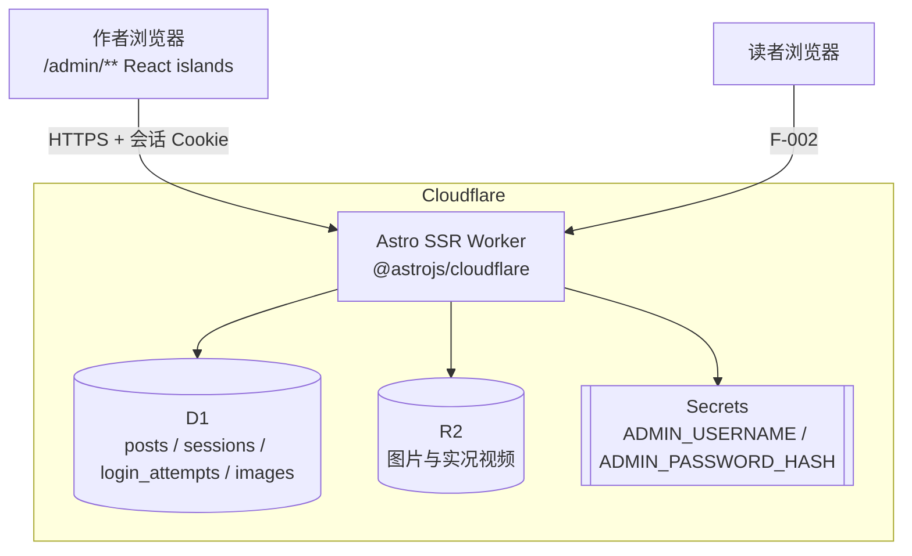
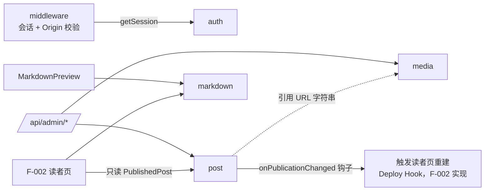

# F-001 文章写作 — 架构设计

**最后更新**: 2026-10-13
**状态**: approved（2026-10-12）

> 输入：[feature-scope.md](../../../../product/features/F-001-文章写作/feature-scope.md)、[stories/_index.md](../../../../product/features/F-001-文章写作/stories/_index.md)、[全局 NFR](../../../../product/nfr.md)、UI 规格（[site-map](../../../../ui/site-map.md)、[components](../../../../ui/components.md)、[pages/](../../../../ui/pages/)）、[article-image-display Backlog](../../../../backlog/article-image-display.md)
>
> F-001 是首个 Feature，同时负责搭建项目骨架（§7）。

---

## 1. 架构概览

### 1.1 系统上下文



浏览器侧承担的重计算（不进 Worker，见 ADR-001、ADR-006）：Markdown 预览渲染、HEIC 转 JPEG、MOV 转封装/转码、图片宽高与主色计算。

### 1.2 技术栈

| 层级 | 技术 | 说明 |
|------|------|------|
| 框架 | Astro 7 + `@astrojs/cloudflare`，`output: 'server'` | `/admin/**` 与 `/api/**` 均 `prerender = false`；读者页构建时预渲染（ADR-001 修订），细节由 F-002 定 |
| 交互 | React 19（Astro islands，`client:load`） | 每个后台页面 = 一个 `.astro` 外壳 + 一个页面级 island |
| 样式 | Tailwind CSS 4 + `@tailwindcss/typography` | 令牌来自 [design-tokens.md](../../../../ui/design-tokens.md) |
| Markdown | unified：`remark-parse` → `remark-gfm` → `remark-rehype` → `rehype-sanitize` → `rehype-expressive-code` → 自定义图片插件 | 同构模块，见 ADR-001 |
| 编辑器 | 原生 `<textarea>` | 见 ADR-004 |
| 图片处理（浏览器） | `heic-to`（libheif WASM，按需加载）、`mediabunny`（MOV→MP4 转封装/转码，按需加载） | 见 ADR-006 |
| 动效组件 | React Bits：SwipeRow、AnimatedList、RefineFrame、ChromaGrid、AccordionGallery；`gsap` | 预览需与读者端一致，图片组件在 F-001 实现（§6） |
| 测试 | Vitest 4.1 + `@cloudflare/vitest-plugin`（原 vitest-pool-workers；D1/R2 本地模拟）；Playwright（E2E） | 写入 CLAUDE.md 命令表（✅ 已实现：setup-workers-test-pool） |

---

## 2. Domain 划分

### 2.1 Domain 列表

| Domain | 类型 | 聚合 / 核心对象 | 职责 |
|--------|------|----------------|------|
| `auth` | 支撑 | AdminSession、LoginThrottle | 凭据校验（PBKDF2）、会话签发/校验/失效、按 IP 限流 |
| `post` | 核心 | Post（工作稿 + 已发布快照） | 新建、自动保存、slug 生成与唯一性、发布 / 发布更新 / 撤回、删除、列表查询与计数、标签补全；对外提供"已发布文章"只读查询（F-002） |
| `media` | 支撑 | Image（静态图，可选配对视频） | 上传校验（类型、大小、配对）、R2 存取、自描述文件名、图片读取路由 |
| `markdown` | 共享内核（非 Domain，无状态） | `renderMarkdown(source) → html` | GFM、XSS 过滤、代码高亮、图片扩展写法解析（ADR-005）；预览与读者端共用 |

### 2.2 Domain 交互图



### 2.3 协作模式

| 上游 | 下游 | 模式 | 说明 |
|------|------|------|------|
| `auth` | middleware → 全部 `/admin/**`、`/api/admin/**` | Open Host Service | 只暴露 `getSession(cookie)`；业务 Domain 不感知认证 |
| `media` | `post` | 无直接调用 | 正文里只存图片 URL；删除文章不删图片（US-09 约束） |
| `post` | F-002 | Customer-Supplier | 只读接口 `listPublished / getPublishedBySlug / listTags`，只返回已发布快照 |
| `post` | 读者页重建（F-002） | 钩子 | `onPublicationChanged({ slug, prevSlug })`：发布/发布更新/撤回/删除后调用；F-001 内为空实现 |
| `markdown` | 后台预览、F-002 | Shared Kernel | 同一份代码，浏览器（Web Worker）与读者页构建时两处运行 |

**铁律落实**：每个 Domain 只访问自己的表（`auth`：`sessions`、`login_attempts`；`post`：`posts`；`media`：`images`），跨 Domain 只通过函数接口。

---

## 3. 数据架构

### 3.1 数据存储

| 存储 | 内容 | 说明 |
|------|------|------|
| D1 `posts` | 文章工作稿字段 + 已发布快照字段 | 见 ADR-002；标签以 JSON 数组存储（千篇以内，`json_each` 查询足够） |
| D1 `sessions` | `token_hash`、`expires_at` | 只存 Token 的 SHA-256；7 天过期；登出删除 |
| D1 `login_attempts` | `ip`、`fail_count`、`locked_until` | 连续 5 次失败锁 15 分钟；成功登录清零 |
| D1 `images` | key、宽高、主色、类型、大小、配对视频 key | 上传记录（审计 / 未来图片库），渲染不依赖它（ADR-005） |
| R2 | `img/{yyyy}/{mm}/{id}_{w}x{h}_{rgb}.{jpg|png|webp|gif}`；配对视频 `…{同名}.live.mp4` | 文件名自描述，`Cache-Control: public, max-age=31536000, immutable` |
| 浏览器 localStorage | `mh:draft:{postId|new}` 本地暂存；`mh:editor:view` 视图模式 | US-06 本地暂存与恢复 |

字段级定义由 design-domain 产出（`data-model.md`）。

### 3.2 数据流（按 US）

| US | 调用链 |
|----|-------|
| US-01 登录 | LoginForm → `POST /api/admin/login` → `auth.login(ip, user, pwd)`（查限流 → PBKDF2 比对 → 建会话）→ `Set-Cookie: mh_session` → 跳 `next` 或 `/admin` |
| US-01 访问保护 | 请求 → `middleware` → `auth.getSession` → 无效：页面 302 `/admin/login?next=…`、接口 401 |
| US-02 登出 | `POST /api/admin/logout` → `auth.logout(token)` 删会话 → 清 Cookie |
| US-03 / US-06 新建与自动保存 | 输入 → 2s 防抖 → 同步写 localStorage → 首次 `POST /api/admin/posts`（返回 id，`history.replaceState`）/ 之后 `PUT /api/admin/posts/:id`（整份工作稿）→ `post.saveDraft` 校验 slug 唯一 → 返回 `updatedAt`；失败指数退避重试 |
| US-03 编辑加载 | SSR：`/admin/posts/[id].astro` 读 `post.getForEdit(id)` → 作为 props 交给 island（无需首屏请求） |
| US-04 预览 | 源码变化 → Web Worker 中 `renderMarkdown` → HTML 回主线程 → 注入预览区；同步滚动用渲染结果上的 `data-line` 映射 |
| US-05 图片上传 | 粘贴/拖入/选择 → 浏览器预处理（配对、HEIC 转换、宽高/主色、视频转封装，见 ADR-006）→ 占位文本 → `POST /api/admin/images`（multipart）→ `media.upload` 校验后写 R2 + `images` → 返回 URL → 替换占位 |
| US-07 列表 | SSR 首屏 + 筛选/搜索/翻页 `GET /api/admin/posts?status&q&page` → `post.list`（含各状态计数） |
| US-08 发布 / 发布更新 / 撤回 | `POST /api/admin/posts/:id/publish` 或 `/unpublish` → `post.publish / unpublish`（校验必填 → 复制/清空快照）→ `onPublicationChanged` |
| US-09 删除 | 写文章页：确认框 → `DELETE /api/admin/posts/:id`；列表：6s 撤销期后 `fetch(…, { method: 'DELETE', keepalive: true })` → `post.delete` → `onPublicationChanged` |
| US-10 格式工具栏 | 纯前端：`EditorToolbar` / 快捷键 → `applyFormat(textarea, command)` → `execCommand('insertText')`（ADR-004） |
| US-11 / US-12（新增，见 §8） | 实况照片成对上传；预览图片菜单改写源码中的 `#wide` / `#accordion` 标记 |

---

## 4. 接口架构

### 4.1 原则

- JSON API，路径 `/api/…`；暂不加版本前缀（只有本站前端调用，前后端同仓同发）
- 写接口（非 GET）全部经 middleware：会话校验 + `Origin` 必须与站点同源，否则 403
- 错误体统一 `{ error: { code, message } }`；`code` 供前端映射文案（如 `SLUG_TAKEN`、`RATE_LIMITED`、`MISSING_FIELDS`、`FILE_TOO_LARGE`、`UNSUPPORTED_TYPE`）
- 自动保存 PUT 幂等（整份覆盖工作稿，后写覆盖，见 US-06 假设）

### 4.2 API 分组

| 分组 | 路径 | 认证 | 端点（契约细节由 design-domain 定） |
|------|------|------|------|
| 认证 | `/api/admin/login`、`/api/admin/logout` | login 无需会话（middleware 豁免）；logout 需会话 | `POST login`、`POST logout` |
| 文章 | `/api/admin/posts*` | 需会话 | `GET` 列表、`POST` 新建、`GET/PUT/DELETE :id`、`POST :id/publish`、`POST :id/unpublish`、`GET /api/admin/tags` |
| 读者只读 | `/api/posts`、`/api/posts/:slug` | 公开 | 已发布快照查询（F-001 用于验证读者可见性，F-002 可直接复用） |
| 图片 | `/api/admin/images` | 需会话 | `POST` 上传（单图或图 + 视频） |
| 图片读取 | `/img/*` | 公开 | Worker 从 R2 读取并返回，长缓存（同源，免额外域名配置） |

---

## 5. 安全架构

### 5.1 认证流程

```
POST /api/admin/login {username, password}
  → login_attempts[ip].locked_until > now ? 429 RATE_LIMITED
  → 常量时间比较 username；PBKDF2-SHA256(password, salt, 100000) 与 ADMIN_PASSWORD_HASH 比较
  → 失败：fail_count+1（≥5 则 locked_until = now+15min）→ 401 INVALID_CREDENTIALS（不区分账号/密码）
  → 成功：清零；token = 32 字节随机；sessions 插入 sha256(token)，expires_at = now+7d
  → Set-Cookie: mh_session=token; HttpOnly; Secure; SameSite=Lax; Path=/; Max-Age=604800
```

- PBKDF2 迭代数取 100,000（Workers WebCrypto 上限）；`ADMIN_PASSWORD_HASH` 格式 `pbkdf2$100000$<salt>$<hash>`，提供 `npm run hash-password` 脚本生成
- 日志不记录密码与 Token（NFR §5）
- 过期会话在校验时惰性删除

### 5.2 权限模型

| 角色 | 权限 |
|------|------|
| 游客 | 读者页、`/img/*`、`/admin/login`、`POST /api/admin/login` |
| 管理员（唯一） | 全部 `/admin/**` 与 `/api/admin/**` |

### 5.3 内容与上传安全

- Markdown：`rehype-sanitize` 在高亮之前执行（白名单 schema，去除 `script`、事件属性、`javascript:` 链接）；高亮与图片插件在 sanitize 之后生成受信任的结构
- 上传：服务端按**文件头魔数**再校验类型（不信任 `Content-Type`）；静态图 png/jpg/webp/gif ≤ 5MB；配对视频 mp4 ≤ 10MB（需改 NFR，见 §8）；禁止 svg
- 文件名由服务端生成随机 id；宽高由服务端从文件头解析（png/jpg/webp/gif 头部均可读），主色由客户端提供、服务端校验格式（6 位 hex）后写入

---

## 6. 前端组件架构

全新项目，以下文件均为**新建**。组件名与 variant 严格按 [components.md](../../../../ui/components.md)。

### 6.1 路由 → 页面 → island

| 路由 | Astro 页面 | React island | 关联 US |
|------|-----------|-------------|---------|
| `/admin/login` | `src/pages/admin/login.astro` | `src/components/admin/LoginForm.tsx` | US-01 |
| `/admin` | `src/pages/admin/index.astro` | `src/components/admin/PostListPage.tsx` | US-02、US-07、US-09 |
| `/admin/posts/new` | `src/pages/admin/posts/new.astro` | `src/components/admin/editor/PostEditorPage.tsx` | US-03 – US-06、US-08 – US-12 |
| `/admin/posts/:id` | `src/pages/admin/posts/[id].astro` | 同上（SSR 传入文章） | 同上 |
| `/api/**` | `src/pages/api/**.ts` | — | — |
| `/img/*` | `src/pages/img/[...key].ts` | — | US-05 |

### 6.2 组件树

```
src/components/
├── ui/                       # 基础 / 反馈组件（components.md "基础组件""反馈组件"）
│   ├── Button.tsx (SpecularButton)   IconButton.tsx   StatusBadge.tsx   TagChip.tsx
│   ├── Field.tsx   SearchInput.tsx   SegmentedControl.tsx   Tabs.tsx
│   ├── SaveIndicator.tsx   Pagination.tsx   Tooltip.tsx (+TooltipGroup, WarmTooltip)
│   └── Alert.tsx   Toast.tsx   ConfirmDialog.tsx   EmptyState.tsx   RestoreBanner.tsx
├── article/                  # 文章图片（components.md "文章图片"），预览与 F-002 共用
│   ├── ArticleImage.tsx (RefineFrame)   LiveBadge.tsx
│   ├── ImageGallery.tsx (ChromaGrid / AccordionGallery)   ← Lightbox 归 F-002
├── admin/
│   ├── LoginForm.tsx   AdminHeader.tsx
│   ├── PostListPage.tsx → PageHeader / SegmentedControl / SearchInput / PostList(AnimatedList) → PostListItem(SwipeRow) / Pagination / Toast(Undo) / EmptyState
│   └── editor/
│       ├── PostEditorPage.tsx           # 状态容器：文章、保存状态、视图模式
│       ├── EditorTopBar.tsx             # 返回、StatusBadge、SaveIndicator、视图切换、设置、主按钮
│       ├── MarkdownEditor.tsx           # 标题 + EditorToolbar + textarea + 底栏；粘贴/拖入
│       ├── EditorToolbar.tsx            # TooltipGroup + 9 个 IconButton
│       ├── MarkdownPreview.tsx          # Web Worker 渲染结果 + hydrate 图片组件 + 图片菜单（US-12）
│       ├── PostSettingsDrawer.tsx       # slug、标签、摘要、日期、撤回、删除
│       └── RestoreBanner / ConfirmDialog / Toast（引用 ui/）
└── lib/ (src/lib/)
    ├── markdown/  render.ts  plugins/{images,line-map}.ts  sanitize-schema.ts  worker.ts
    ├── editor/    format-commands.ts（纯函数 + execCommand 适配）  shortcuts.ts  scroll-sync.ts
    ├── autosave/  useAutosave.ts  local-draft.ts
    └── upload/    pair-files.ts  heic.ts  motion-photo.ts  video-remux.ts  image-meta.ts  upload-client.ts
```

后端：

```
src/
├── middleware.ts
├── domains/
│   ├── auth/   service.ts  password.ts  session-repo.ts  throttle-repo.ts
│   ├── post/   service.ts  post.ts（聚合：状态、快照、slug 规则）  repo.ts  published-query.ts（F-002 只读）  hooks.ts
│   └── media/  service.ts  validate.ts（魔数、大小）  key.ts  repo.ts
└── db/migrations/*.sql
```

### 6.3 预览中的组件渲染

`renderMarkdown` 输出纯 HTML。图片节点输出带 `data-*` 的占位结构（`<figure data-article-image data-src data-w data-h data-rgb data-live data-wide>`、`<div data-gallery="grid|accordion">`）。`MarkdownPreview` 注入 HTML 后，用 `createRoot` 把这些占位挂成 `ArticleImage` / `ImageGallery`。F-002 用同样的约定在读者页做 island 水合。不在每次输入时重建图片：按 `src` 复用已挂载的实例，避免图片反复走加载动画。

### 6.4 前置确认项

| 项 | 说明 |
|----|------|
| ⚠️ Expressive Code 在浏览器 Web Worker 中运行 | Sprint 1 首个验证任务（spike）：打包体积、万字文章渲染 < 300ms；失败退路见 ADR-001 |
| ⚠️ React Bits 组件 | 按 components.md 参数从源码引入（非 npm 包），进入 `src/components/vendor/react-bits/`，许可证随文件保留 |
| ⚠️ `execCommand('insertText')` | 已废弃但主流浏览器均支持；不支持时退回 `setRangeText`（失去原生撤销），见 ADR-004 |

---

## 7. 部署与项目骨架（✅ 骨架已实现：scaffold-project-skeleton）

| 环境 | 用途 | 绑定 |
|------|------|------|
| 本地 | `npm run dev`（Astro dev + wrangler 平台代理） | 本地 D1/R2 模拟 |
| Preview | 分支推送自动构建 | 预览用 D1/R2 |
| Production | `main` 推送自动构建 | 生产 D1（Time Travel 开启）、R2；Secrets |

- `wrangler.jsonc` 声明 `DB`（D1）、`MEDIA`（R2）绑定；迁移用 `wrangler d1 migrations`，目录 `src/db/migrations`（✅ 已实现）
- 适配器关闭 KV 会话（`session: false`）与 Cloudflare Images（`imageService: "passthrough"`），分别由 ADR-003、ADR-005 覆盖
- 备份：GitHub Actions 每周 `wrangler d1 export` 上传为 artifact（NFR §3），可手动触发

---

## 8. 跨 Feature 影响与范围变更

### 8.1 对 F-002 的影响

| 影响 | 处理 |
|------|------|
| `post` 只读接口 | F-002 只能用 `published-query.ts`，读不到工作稿 |
| 渲染规则 | F-002 使用 `src/lib/markdown`，不得另写渲染 |
| 图片组件 | `ArticleImage`、`LiveBadge`、`ImageGallery` 由 F-001 实现；`Lightbox` 仍归 F-002 |
| 读者页重建 | 读者页构建时预渲染；F-002 实现 `onPublicationChanged` 为调用 Workers Builds Deploy Hook，重建完成后可见（P95 ≤ 5 分钟） |

### 8.2 范围变更（本阶段决策：实况照片 / 宽图 / 组图 F-001 全做）

| 变更 | 需回补的上游 |
|------|-------------|
| 新增 US-11 实况照片上传（图 + 视频配对、HEIC、Motion Photo） | feature-scope、write-story、write-behavior、design-acceptance |
| 新增 US-12 图片排版标记（`#wide` / 组图 / 手风琴写法 + 预览图片菜单） | 同上 + design-ui（图片菜单的页面规格与设计稿） |
| NFR 上传限制：增加 heic/heif（浏览器端转换后实际上传 jpg）与配对 mp4 ≤ 10MB | nfr.md |
| Backlog `article-image-display` 中 F-001 部分转入本 Feature | backlog 条目 |

上述回补完成前，本 Feature 不进入 plan-tasks。

---

## 9. 技术决策记录（ADR）

| ADR | 决策 | 状态 |
|-----|------|------|
| [ADR-001](adr/ADR-001-isomorphic-markdown.md) | Markdown 同构渲染：预览在浏览器 Web Worker，读者端在 Worker SSR | Accepted |
| [ADR-002](adr/ADR-002-post-snapshot-model.md) | 文章单行"工作稿 + 已发布快照"模型 | Accepted |
| [ADR-003](adr/ADR-003-d1-session.md) | 服务端会话存 D1，Token 只存摘要 | Accepted |
| [ADR-004](adr/ADR-004-textarea-editor.md) | 源码区用原生 textarea，格式命令走 `execCommand('insertText')` | Accepted |
| [ADR-005](adr/ADR-005-self-describing-image-markdown.md) | 自描述图片 URL + GFM 兼容的扩展写法 | Accepted |
| [ADR-006](adr/ADR-006-live-photo-browser-processing.md) | 实况照片在浏览器端配对与转换（参考 Afilmory） | Accepted |

---

## 变更历史

| 日期 | 版本 | 变更内容 | 作者 |
|------|------|----------|------|
| 2026-10-12 | 1.0 | 初始版本 | miraclehifi |
| 2026-10-13 | 1.1 | design-domain 回写：认证路径改为 `/api/admin/login`、`/api/admin/logout`（与验收用例一致）；新增读者只读接口分组；详细契约见 `backend/domains/*/api-contract.md` | miraclehifi |
| 2026-10-13 | 1.2 | 框架由 Astro 5 改为 Astro 7（作者决定，implement 开始时）| miraclehifi |
| 2026-10-13 | 1.3 | 读者页改为构建时预渲染，缓存失效钩子改为触发重建（ADR-001 修订） | miraclehifi |
