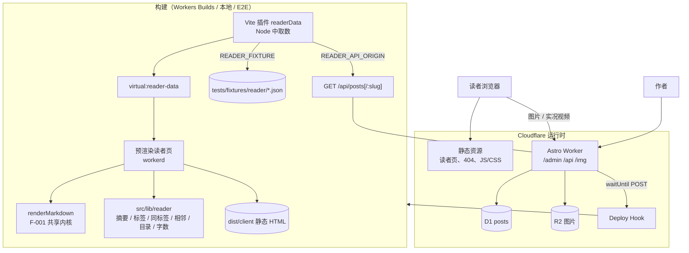

# F-002 博客首页与阅读 — 架构设计

**最后更新**: 2026-10-15
**状态**: approved（2026-10-15，作者授权文档不逐项确认）

> 输入：[feature-scope.md](../../../../product/features/F-002-博客首页与阅读/feature-scope.md)、[stories/_index.md](../../../../product/features/F-002-博客首页与阅读/stories/_index.md)、[验收用例](../../../../test/features/F-002-博客首页与阅读/acceptance/)、UI 规格（[reader-shell](../../../../ui/pages/reader-shell.md)、[reader-home](../../../../ui/pages/reader-home.md)、[reader-post-list](../../../../ui/pages/reader-post-list.md)、[reader-post-detail](../../../../ui/pages/reader-post-detail.md)、[components](../../../../ui/components.md)）、F-001 [feature-architecture](../../F-001-文章写作/architecture/feature-architecture.md)、[shared-domains](../../../shared-domains.md)

---

## 1. 架构概览



- 读者访问 `/`、`/posts*`、`/tags/*`、404 只命中静态资源，不执行 Worker 代码；图片仍经 `/img/*`（F-001）
- 作者发布 / 发布更新 / 撤回 / 删除 → Worker 写 D1 → `waitUntil` 调 Deploy Hook → Workers Builds 重建 → 新静态页上线（ADR-007）

### 1.1 技术栈增量

| 层 | 选型 | 说明 |
|----|------|------|
| 预渲染 | Astro `prerender = true` + `getStaticPaths`，运行在 workerd（适配器默认） | ADR-007 |
| 构建数据 | Vite 虚拟模块 `virtual:reader-data` | ADR-007 |
| 交互 | 原生脚本为主；React 岛只用于正文图片 + 灯箱、文章列表 | ADR-008 |
| 灯箱 | React Bits DepthCarousel（`src/components/vendor/react-bits/`）+ `gsap`（已装 3.15） | components.md"灯箱层叠参数" |
| 纯文本提取 | `mdast-util-to-string`（remark 生态，已间接依赖）| 摘要、字数，不走完整渲染 |

---

## 2. Domain 边界与职责

F-002 **不新增 Domain**。只读 `post`，在 `post` 上做一处 F-001 增量（封面），新增两个无状态模块。

| Domain / 模块 | 归属 | F-002 中的变化 |
|---------------|------|---------------|
| `post` | F-001 | **增量**：`PostContent` 新增 `cover`（工作稿与快照各一份，迁移 0003）；`PublishedPost` / `PublishedPostSummary` / `PostView` 返回 `cover`；`contentHash` 兼容旧数据（`cover` 为空时序列化不变）。钩子接口不变，由 F-002 注入实现 |
| `media` | F-001 | 无变化。封面复用 `POST /api/admin/images`；校验 `cover` 只用 `parseImageKey`（`markdown` 模块）判断是否为站内图片地址 |
| `markdown` | F-001 | 无变化；构建时由读者页调用 |
| `reader`（新，无状态模块，非 Domain） | F-002 | `src/lib/reader/`：构建期视图模型——摘要、标签分组与地址、同标签文章、相邻文章、目录、字数与阅读时长、站点配置校验。只消费 `PublishedPost` 数据，不访问 D1 |
| `rebuild`（新，适配器） | F-002 | `src/lib/rebuild/deploy-hook.ts`：`PublicationHooks` 的 Deploy Hook 实现 |

**铁律落实**：F-002 运行时不读 D1；构建期只经公开接口 `GET /api/posts[/:slug]`（只返回已发布快照）或夹具取数。

### 2.1 接口增量（契约细节由 design-domain 定）

| 接口 | 变化 |
|------|------|
| `GET /api/posts`、`GET /api/posts/:slug` | 响应新增 `cover: string \| null`（快照） |
| `GET /api/admin/posts/:id`、`GET /api/admin/posts`、`PUT`/`POST` | `PostView` 新增 `cover`；`DraftInput` 新增必填字段 `cover`（`null` 或站内图片地址），缺字段 400（沿用"六个字段都必须出现"，改为七个） |
| `POST /api/admin/posts/:id/publish`、`/unpublish`、`DELETE /api/admin/posts/:id` | 行为不变；路由注入 `createDeployHookHooks`，成功后异步触发重建 |

---

## 3. 数据流（按 US）

| US | 调用链 |
|----|-------|
| US-01 外壳 | 构建：`BaseLayout`（内联主题脚本）→ `ReaderLayout`（`SiteHeader` / `SiteNav` / `ThemeToggle` / `BackLink` / `SiteFooter`）；`site.ts` 经 `normalizeSiteConfig` 校验。运行：`ThemeToggle` 原生脚本写 `localStorage.theme` 与 `<html data-theme>`。404：`src/pages/404.astro` 预渲染为 `404.html`，Worker 未匹配时由适配器的错误页取回 |
| US-02 首页 | 构建：`index.astro` 读 `site.ts` → `HomeIntro` |
| US-03 重建 | 构建：`readerData()` 取数 → `virtual:reader-data` → 各页 `getStaticPaths`。运行：发布等路由 → `post.publish/unpublish/delete` → `hooks.onPublicationChanged` → `waitUntil(fetch(DEPLOY_HOOK_URL, POST))` |
| US-04 列表 | 构建：`posts/index.astro`、`posts/page/[page].astro` → `sortPublished` → 每页 20 → `toCardModel`（`excerptOf`、`tagSlug`）→ `PostCardList`（React 岛，SSR 输出）+ `Pagination`（SSR 静态）；第 1 页 `TagIndex`（`groupTags`） |
| US-05 标签页 | 构建：`tags/[tag]/index.astro`、`tags/[tag]/page/[page].astro`，`getStaticPaths` 由 `groupTags` 生成（只含已发布文章的标签） |
| US-06 封面 | 运行：设置抽屉 `CoverField` → `useImageUploads` 单文件路径（`fileToItem` 动态照片只取静态图）→ `POST /api/admin/images` → `onChange(url)` → 自动保存 `PUT`（`cover`）→ `post.saveDraft`（校验、`contentHash` 含 cover）→ 发布时进入快照 |
| US-07 正文 | 构建：`posts/[slug].astro` → `renderMarkdown(body)` → `ArticleHeader`（`readingStats`、`updatedDate`）+ `ArticleContent`（`set:html`；h1 降级与首字下沉标记由 `prepareArticleHtml` 在渲染结果上处理） |
| US-08 三栏 | 构建：`extractToc(html)`、`relatedPosts(post, all)` → `TagPostsNav` / `TableOfContents` / `TocDrawer`。运行：原生脚本计算进度、当前章节、抽屉开合 |
| US-09 相邻 | 构建：`adjacentPosts(slug, sorted)` → `PostPager` |
| US-10 图片与灯箱 | 构建：正文中 `figure[data-article-image]` / `div[data-gallery]` 静态输出。运行：`ArticleImagesIsland`（`client:idle`）挂载 `ArticleImage` / `ImageGallery`，传 `onItemClick` / `onActiveClick` → 首次打开时动态加载 `Lightbox`（DepthCarousel + gsap） |

---

## 4. 前端组件架构

### 4.1 路由 → 页面 → 组件

| 路由 | 页面文件（新建） | 主要组件 | 交互 | US |
|------|----------------|---------|------|----|
| `/` | `src/pages/index.astro` | `HomeIntro` | 主题脚本 | US-01、02 |
| `/posts` | `src/pages/posts/index.astro` | `PostsHeader`、`TagIndex`、`PostCardList`、`Pagination` | React 岛（列表） | US-04 |
| `/posts/page/:n` | `src/pages/posts/page/[page].astro` | 同上（无 `TagIndex`） | 同上 | US-04 |
| `/posts/:slug` | `src/pages/posts/[slug].astro` | `ArticleHeader`、`ArticleContent`、`TagPostsNav`、`TableOfContents`、`TocDrawer`、`PostPager`、`ArticleImagesIsland` | 原生脚本 + React 岛（有图时） | US-07–10 |
| `/tags/:tag` | `src/pages/tags/[tag]/index.astro` | `PostsHeader`（标签）、`PostCardList`、`Pagination` | React 岛（列表） | US-05 |
| `/tags/:tag/page/:n` | `src/pages/tags/[tag]/page/[page].astro` | 同上 | 同上 | US-05 |
| 404 | `src/pages/404.astro` | `NotFound` | 主题脚本 | US-01 |
| `/admin/posts/*`（已有） | 不变 | `PostSettingsDrawer` **修改**：新增 `CoverField` | React | US-06 |

所有读者页 `export const prerender = true`。`/posts/page` 与 `/posts/[slug]` 层级不同，不冲突（slug 恰为 `page` 时 `/posts/page` 仍是详情页）。

### 4.2 组件树（组件名按 [components.md](../../../../ui/components.md)）

```
src/
├── config/site.ts                         # 新建：首页与外链配置（占位内容）
├── integrations/reader-data.ts            # 新建：Vite 插件 readerData()（ADR-007）
├── layouts/
│   ├── BaseLayout.astro                   # 修改：<head> 内联主题脚本；props 增加 description
│   └── ReaderLayout.astro                 # 新建：SiteHeader + <main> + BackLink + SiteFooter，props: current、back
├── components/
│   ├── reader/                            # 新建
│   │   ├── SiteHeader.astro  SiteNav.astro  ThemeToggle.astro(+script)  SiteFooter.astro  BackLink.astro
│   │   ├── HomeIntro.astro  NotFound.astro
│   │   ├── PostsHeader.astro  TagIndex.astro
│   │   ├── PostCard.tsx  PostCardList.tsx（AnimatedList，bare）
│   │   ├── ArticleHeader.astro  ArticleContent.astro  TagPostsNav.astro  PostPager.astro
│   │   ├── TableOfContents.astro  ReadingProgress.astro  TocDrawer.astro（<dialog>）  reading.ts（进度 / 当前章节纯函数 + 绑定脚本）
│   │   ├── ArticleImagesIsland.tsx        # 挂载正文图片组件 + 灯箱状态
│   │   └── Lightbox.tsx                   # 外壳：scrim、计数、关闭、图注、下滑关闭、焦点陷阱、滚动锁
│   ├── vendor/react-bits/DepthCarousel.tsx   # 新建：按 components.md"灯箱层叠参数"改源码
│   ├── ui/Pagination.tsx                  # 复用（href 模式，SSR 静态输出，不水合）
│   ├── ui/TagChip.tsx                     # 复用（链接形态：新增 href）
│   ├── ui/EmptyState.tsx                  # 复用（/posts 空态）
│   ├── article/ArticleImage.tsx  ImageGallery.tsx  LiveBadge.tsx   # 复用（F-001）
│   └── admin/editor/
│       ├── CoverField.tsx                 # 新建
│       └── PostSettingsDrawer.tsx         # 修改：插入 CoverField
├── lib/
│   ├── reader/                            # 新建：纯函数（单元测试）
│   │   ├── types.ts  sort.ts  excerpt.ts  tags.ts  related.ts  adjacent.ts
│   │   ├── toc.ts  reading-stats.ts  article-html.ts（h1 降级、首字下沉标记、署名）  site-config.ts
│   ├── rebuild/deploy-hook.ts             # 新建
│   └── markdown/reconcile-islands.ts      # 复用（ArticleImagesIsland 与预览共用挂载规则）
├── domains/post/                          # 修改：content.ts、content-hash.ts、repo.ts、published-query.ts、service.ts（cover）
├── pages/api/admin/posts/[id]/publish.ts、unpublish.ts、[id].ts   # 修改：注入 Deploy Hook 钩子
└── db/migrations/0003_post_cover.sql      # 新建
```

引用署名（`blockquote` 末段 `— `）放在 `renderMarkdown` 的插件里还是读者页后处理？→ 放入 **markdown 模块**（新插件 `rehypeQuoteAttribution`），保证预览与读者页一致（TC-US07-09"预览与读者页一致"）。这是对 F-001 共享内核的增量，design-domain 写入 markdown module-spec。h1 降级、首字下沉标记只影响读者页版式，放在 `lib/reader/article-html.ts`。

### 4.3 归属与复用判断

| 组件 | 归属 | 判断 |
|------|------|------|
| `ArticleImage` / `ImageGallery` / `LiveBadge` | 本地（F-001） | 复用；读者页传 `onItemClick` / `onActiveClick`（ImageGallery 已有 `onImageClick`，单图需新增 `onClick` 或包裹按钮，design-domain 定） |
| `AnimatedList` | 本地 vendor（F-001 已改造 `bare`） | 复用 |
| `Pagination` | 本地 ui | 复用 href 模式；需确认 SSR 输出不依赖 hydrate |
| `TagChip` | 本地 ui | 新增链接形态 |
| DepthCarousel | React Bits 源码（MIT + Commons Clause，同 SwipeRow） | 新引入，⚠️ 前置确认项 |
| 外部 SDK / npm UI 包 | — | 无 |

### 4.4 前置确认项

| 项 | 说明 |
|----|------|
| ⚠️ 预渲染 spike（Sprint 首个任务） | 验证：① `virtual:reader-data` 在 workerd 预渲染中可用；② 虚拟模块数据与 `renderMarkdown` 不进入运行时 Worker 包；③ 预渲染页面中 React 岛（`client:idle` / `client:visible`）正常输出；④ 标签参数含 `#`、空格、`/`、中文时路径生成与访问；⑤ `404.astro` 预渲染并对未知路径返回 404 状态；⑥ `astro preview`（E2E 环境）下读者页走静态资源。任一失败按 ADR-007"退路" |
| ⚠️ DepthCarousel 源码 | 取自 React Bits 仓库，许可证同 SwipeRow；按 components.md 补 6 处源码改动 |
| ⚠️ 首次部署 | 需在 Workers Builds 设置 `READER_API_ORIGIN`、首次 `READER_BOOTSTRAP=1`，并添加 Secret `DEPLOY_HOOK_URL`（README） |
| ⚠️ 重建时长 | 线上实测 TC-US03-10（verify 阶段，人工） |

---

## 5. 构建与部署

| 环境 | 读者数据 | Deploy Hook |
|------|---------|------------|
| 本地 `npm run dev` | `READER_FIXTURE=reader-fixture`（默认） | 无 |
| E2E（`npm run test:e2e`：build + preview） | `READER_FIXTURE=reader-fixture`（Playwright webServer 环境变量） | 无（集成测试注入替身） |
| Production（Workers Builds） | `READER_API_ORIGIN=https://{站点域名}` | Secret `DEPLOY_HOOK_URL` |

- `wrangler.jsonc`：`assets.not_found_handling` 设为 `"404-page"`（适配器生成配置时保留，spike 验证）；无新增绑定
- `.dev.vars` / E2E `vars` 不含 `DEPLOY_HOOK_URL`
- 构建失败（取数失败）时 Workers Builds 不发布新版本，线上保持上一版

---

## 6. 跨 Feature 影响

| 已有 Feature | 影响维度 | 描述 | 需要的动作 |
|-------------|---------|------|-----------|
| F-001 | 共享实体（post） | 新增 `cover` 字段（工作稿 + 快照）；`DraftInput` 多一个必填字段 | 迁移 0003；`content.ts` / `content-hash.ts`（空 cover 不改变旧哈希）/ `repo.ts` / `published-query.ts` / API 契约；前端 `PostEditorPage` 状态、本地暂存（`local-draft` 格式加 `cover`，旧暂存缺字段按 `null` 读）、自动保存请求体 |
| F-001 | 共享实体（post） | 旧文章迁移后 `cover` 为 null，不产生"有未发布修改" | 哈希兼容规则 + TC-US06-09 |
| F-001 | 生命周期 | 发布 / 发布更新 / 撤回 / 删除触发重建（原为空实现） | 三个路由注入钩子；失败不影响发布（F-001 已约定） |
| F-001 | 共享内核（markdown） | 新增引用署名插件，预览同步生效 | markdown module-spec、MD 单元测试；预览外观变化（F-001 无对应验收，F-002 TC-US07-08/09 覆盖） |
| F-001 | 共享组件（article） | 单图需要点击回调接灯箱 | `ArticleImage` 新增可选 `onClick`（不传时行为不变，预览不受影响） |
| F-001 | 布局 | `BaseLayout` 新增内联主题脚本 | 后台页面也会按读者端选择的主题显示（UI 决定 #6）；F-001 E2E 中的主题断言需回归 |
| F-001 | 测试 | Playwright webServer 构建需带 `READER_FIXTURE` | `playwright.config.ts` 环境变量；夹具文件 `tests/fixtures/reader/reader-fixture.json` 与种子图片 |
| F-003 / F-004 / F-005 | 后续读者页 | 复用 `ReaderLayout`、`virtual:reader-data` 模式；F-004 Pagefind 在构建后索引 `dist/client` | 无需本 Feature 动作 |

---

## 7. 关键决策

| ADR | 决策 | 状态 |
|-----|------|------|
| [ADR-007](adr/ADR-007-reader-build-data.md) | 读者页构建数据经 Vite 虚拟模块一次性注入（线上接口 / 夹具）；预渲染保持 workerd；Deploy Hook 重建，失败只记日志 | Accepted |
| [ADR-008](adr/ADR-008-reader-interactivity.md) | 读者页交互原生脚本优先，React 岛只用于正文图片 + 灯箱、文章列表 | Accepted |

---

## 变更历史

| 日期 | 版本 | 变更内容 | 作者 |
|------|------|----------|------|
| 2026-10-15 | 1.0 | 初始版本 | miraclehifi |
