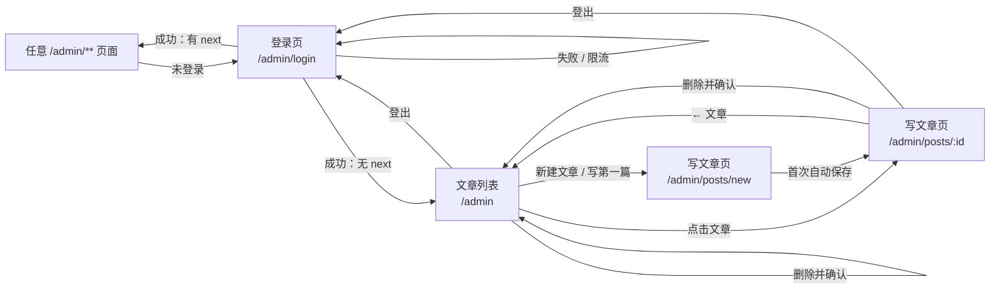
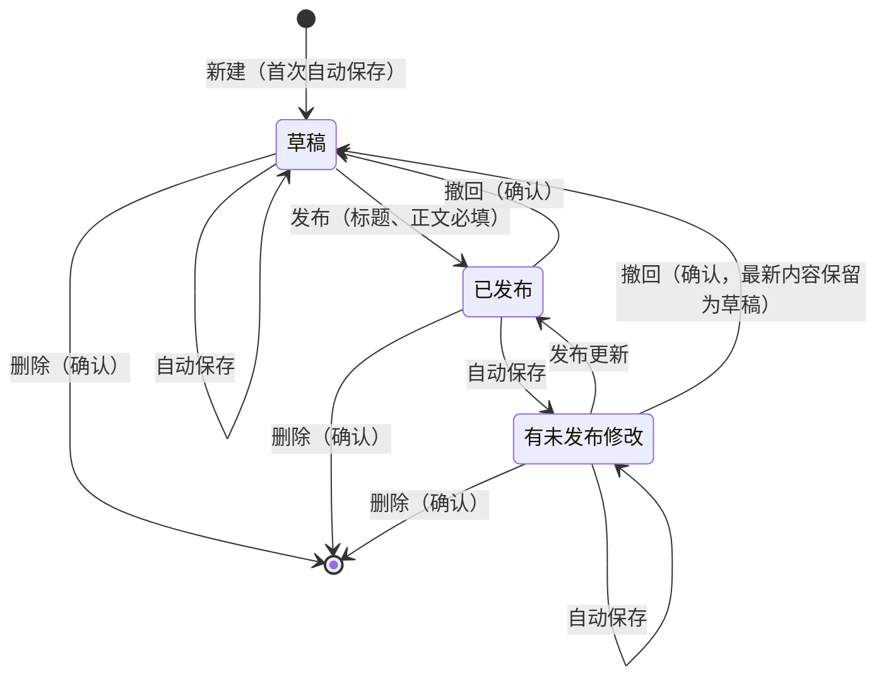
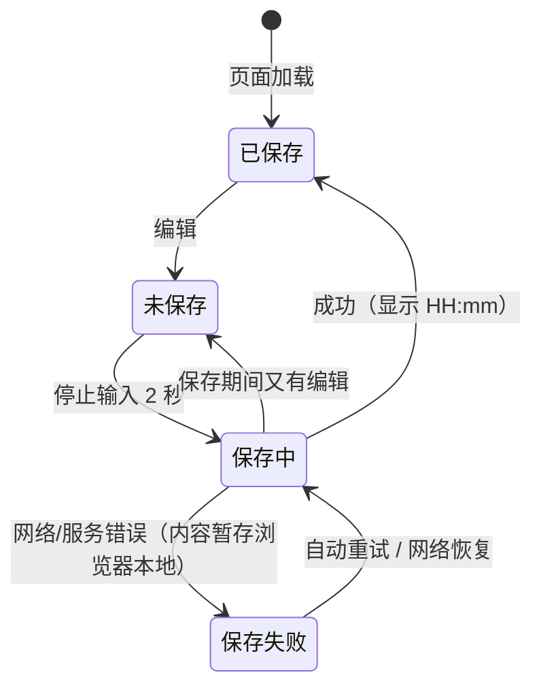
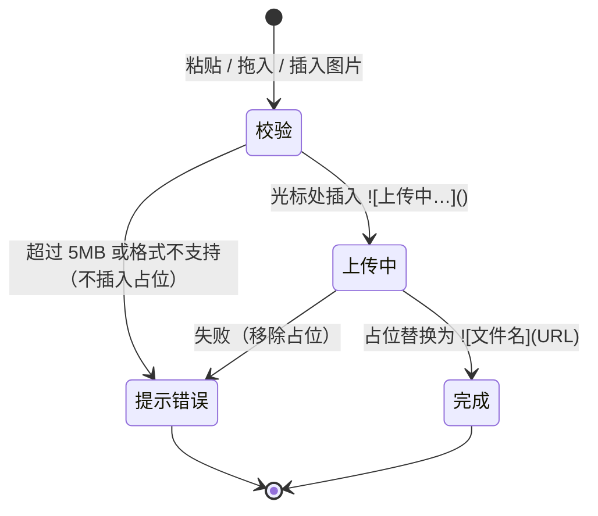

# 用户流程（作者后台）

**最后更新**: 2026-10-10
**关联 Feature**: F-001-文章写作

## 1. 页面跳转

说明：新建页首次自动保存成功后，地址用 `history.replaceState` 换成 `/admin/posts/:id`，不刷新页面。

## 2. 文章状态

## 3. 保存状态（写文章页顶栏）

## 4. 图片上传（编辑区）

多张图片：每张各自插入占位、按顺序替换。

## 变更历史

| 日期 | 变更 | 作者 |
|------|------|------|
| 2026-10-10 | 初始版本 | miraclehifi |
